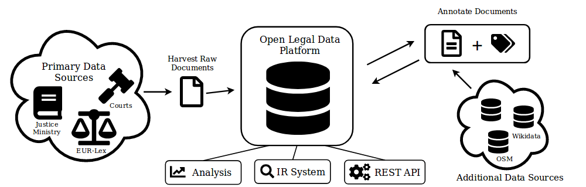

## Open Data, API and MCP

Open Legal Data collects German court decisions and laws from official
sources, extracts metadata and the citations between them, and publishes
everything as open data. Pick the access that fits your use case:

<div class="row card-grid">
    <div class="col-12 col-md-4">
        <div class="info-card">
            <h4>MCP for AI agents</h4>
            <p>Let Claude, ChatGPT or your own agent research case law and legislation with verifiable sources.</p>
            <a class="card-link" href="#mcp">Connect your assistant →</a>
        </div>
    </div>
    <div class="col-12 col-md-4">
        <div class="info-card">
            <h4>REST API</h4>
            <p>Search and fetch decisions, laws, courts and citations as JSON for your apps and scripts.</p>
            <a class="card-link" href="#api">Get started →</a>
        </div>
    </div>
    <div class="col-12 col-md-4">
        <div class="info-card">
            <h4>Datasets</h4>
            <p>Download the complete corpus from Hugging Face for analysis, research and model training.</p>
            <a class="card-link" href="#datasets">Browse datasets →</a>
        </div>
    </div>
</div>

### MCP server for AI assistants {#mcp}

With the [Model Context Protocol](https://modelcontextprotocol.io), AI
assistants can work directly with Open Legal Data: search court decisions and
laws, read full texts, validate citations and follow the citation graph
between cases and laws. Answers can link to the sources, so you can check
them.

Server URL:

```text
{{ site.links.mcp_server }}
```

- **claude.ai and Claude Desktop:** add a custom connector under
  *Settings → Connectors* and enter the server URL.
- **Claude Code:** `claude mcp add --transport http oldp {{ site.links.mcp_server }}`
- **ChatGPT:** add a custom MCP server in the browser on chatgpt.com
  (depending on your plan); the step-by-step guide is on our
  [API page]({{ site.links.api_docs }}#mcp) and in the
  [ChatGPT help](https://help.openai.com/en/articles/12584461-developer-mode-and-mcp-apps-in-chatgpt).
- **Other clients** (Cursor, your own agents, …): add the URL as a
  "Streamable HTTP" server. Clients without OAuth can send an API token in the
  `Authorization: Token …` header.

The server works without an account. Signing in via OAuth (or using an API
token) gives you a personal, higher request budget, shared with the REST API.

Example prompts:

- "Which decisions of the Federal Court of Justice since 2020 deal with § 823 BGB and personality rights?"
- "Summarise the decision [file number] and list the laws it cites."
- "Check whether these citations exist: [file numbers, ECLI or sections]"

All tools and parameters are described in the
[MCP documentation]({{ site.links.mcp_docs }}).

### REST API {#api}

The API at `https://de.openlegaldata.io/api/` returns JSON (or XML with
`?format=xml`). Try requests in the
[Swagger UI]({{ site.links.api_swagger }}) or start with:

```bash
# Decisions mentioning "Mietminderung" (rent reduction)
curl "https://de.openlegaldata.io/api/cases/search/?text=Mietminderung"

# Decisions citing § 823 BGB that mention "Persönlichkeitsrecht"
curl -G "https://de.openlegaldata.io/api/cases/search/" \
  --data-urlencode "text=Persönlichkeitsrecht" \
  -d cited_law_book=bgb -d cited_law_section=823
```

| Area | Endpoints |
|------|-----------|
| Court decisions | `/api/cases/`, `/api/cases/search/` |
| Laws | `/api/law_books/`, `/api/laws/`, `/api/laws/search/` |
| Courts | `/api/courts/` |
| Citations | `/api/cases/<id>/references/`, `/api/cases/<id>/citing_cases/`, `/api/citations/validate/` |

Requests work without an account. With a
[free account]({{ site.links.signup }}) and an API token the limits are
considerably higher. Endpoints, limits and token setup are documented on the
[API page]({{ site.links.api_docs }}) (in German); developer documentation is
on [openlegaldata.github.io/oldp](https://openlegaldata.github.io/oldp/).
Please do not page through the API to download everything: use the datasets
instead.

### Datasets {#datasets}

We publish regular snapshots of the database on
[Hugging Face]({{ site.links.huggingface }}). Each dataset is versioned per
dump and has random 1k and 10k samples for quick experiments.

| Dataset | Content | Size |
|---------|---------|------|
| [court-decisions-germany](https://huggingface.co/datasets/openlegaldata/court-decisions-germany) | Court decisions with metadata, HTML and Markdown | {{ site.data.stats.court_decisions }} |
| [laws-germany](https://huggingface.co/datasets/openlegaldata/laws-germany) | Laws, one row per section, HTML and Markdown | {{ site.data.stats.laws }} |
| [legal-citation-graph-germany](https://huggingface.co/datasets/openlegaldata/legal-citation-graph-germany) | Citations between decisions and laws | {{ site.data.stats.citations }} |

```python
from datasets import load_dataset

cases = load_dataset(
    "openlegaldata/court-decisions-germany",
    name="dump-20260520-1k",  # see the dataset card for the latest dump
    split="train",
)
```

The dataset cards list the available dumps; the release posts on our
[blog]({{ '/blog/' | relative_url }}) have statistics per dump. To process the raw data yourself, use the
[oldp-toolkit](https://github.com/openlegaldata/oldp-toolkit).

#### License

In Germany, laws, official decrees and court decisions are not protected by
copyright (§ 5 UrhG). The collection and its metadata are released under the
[Open Database License (ODbL) v1.0](https://opendatacommons.org/licenses/odbl/1-0/).
If you use the data in research, please [cite our paper]({{ '/research/#cite' | relative_url }}).

### How it works



*Open Legal Data harvests legal documents from official sources, extracts
information from the raw documents and enriches them with data from
additional sources. The content is available through the website, the API,
the MCP server and the datasets.*

All code is open source on [GitHub]({{ site.links.github }}) under the MIT
license. Questions or ideas? Join us on [Discord]({{ site.links.discord }}).
